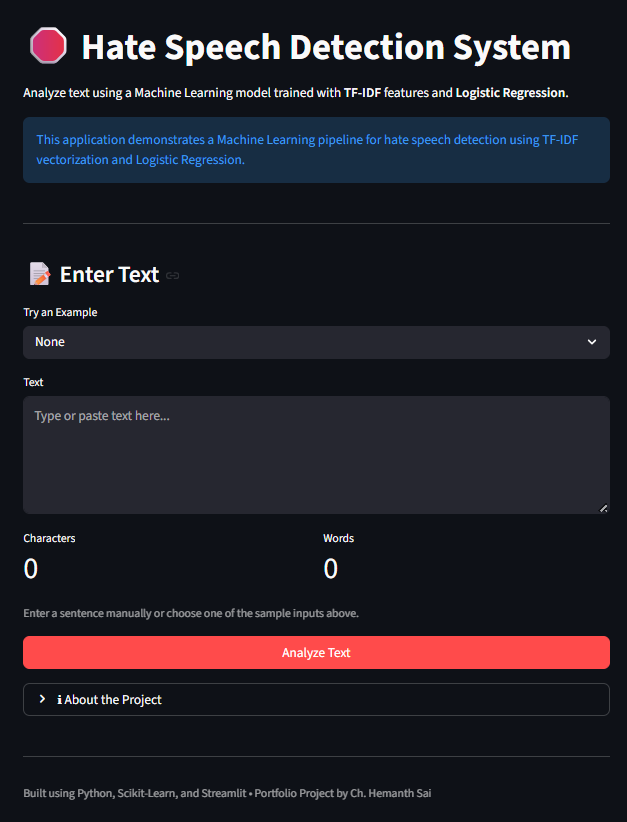
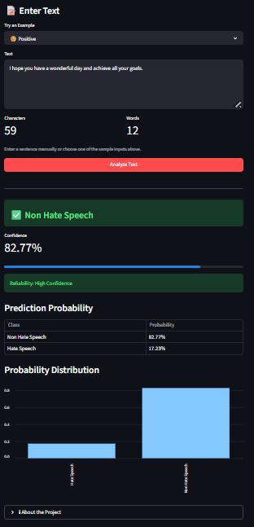
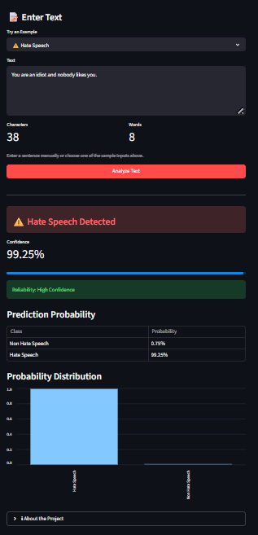

<div align="center">

# 🛑 Hate Speech Detection System

### Real-Time Hate Speech Detection using Natural Language Processing and Machine Learning

[]()
[]()
[](https://hemanth-hate-speech-detection.streamlit.app/)
[]()

### 🔗 Live Demo
**https://hemanth-hate-speech-detection.streamlit.app/**

Detect hate speech in real time using a Machine Learning pipeline built with **TF-IDF Vectorization**, **Logistic Regression**, and an interactive **Streamlit** web application.

</div>

---

# 📘 Overview

Hate speech has become a major challenge across online platforms, making automated content moderation increasingly important.

This project demonstrates an end-to-end Natural Language Processing (NLP) pipeline capable of classifying text as **Hate Speech** or **Non Hate Speech**. The workflow includes text preprocessing, feature extraction using TF-IDF, model training with Logistic Regression, and deployment through an interactive Streamlit application.

The project emphasizes clean project organization, reusable preprocessing functions, and a user-friendly interface for real-time inference.

---

# 🎯 Project Objectives

- Build an NLP pipeline for hate speech classification
- Apply text preprocessing techniques
- Transform text using TF-IDF Vectorization
- Train a Logistic Regression classifier
- Deploy the trained model with Streamlit
- Provide confidence scores and prediction probabilities
- Demonstrate an end-to-end Machine Learning workflow

---

# ✨ Features

- Real-time hate speech prediction
- Interactive Streamlit interface
- TF-IDF text vectorization
- Logistic Regression classifier
- Confidence score visualization
- Prediction probability distribution
- Sample input examples
- Shared preprocessing pipeline
- Cached model loading for faster inference

---

# 🧠 Machine Learning Workflow

```
Input Text
      │
      ▼
Text Preprocessing
      │
      ▼
TF-IDF Vectorization
      │
      ▼
Logistic Regression
      │
      ▼
Prediction
      │
      ▼
Confidence Score
      │
      ▼
Interactive Streamlit Interface
```

---

# 📂 Repository Structure

```text
Hate-Speech-Detection-System/
│
├── data/
│   └── dataset_information.md
│
├── models/
│   ├── hate_speech_model.pkl
│   └── tfidf_vectorizer.pkl
│
├── screenshots/
│   ├── home_page.png
│   ├── non_hate_prediction.png
│   └── hate_prediction.png
│
├── src/
│   ├── preprocessing.py
│   └── train.py
│
├── app.py
├── requirements.txt
├── README.md
├── LICENSE
└── .gitignore
```

---

# 🛠️ Tech Stack

| Category | Technologies |
|----------|--------------|
| Programming | Python |
| Machine Learning | Scikit-Learn |
| NLP | TF-IDF Vectorization |
| Model | Logistic Regression |
| Data Processing | Pandas, NumPy |
| Deployment | Streamlit |
| Utilities | Joblib, NLTK |

---

# 📸 Application Preview

## Home Page

<p align="center">

</p>

---

## Prediction Example (Non Hate Speech)

<p align="center">

</p>

---

## Prediction Example (Hate Speech)

<p align="center">

</p>

---

# ⚙️ Installation

### 1. Clone the Repository

```bash
git clone https://github.com/Hemanthsai456/Hate-Speech-Detection-System.git
cd Hate-Speech-Detection-System
```

### 2. Install Dependencies

```bash
pip install -r requirements.txt
```

### 3. Train the Model (Optional)

If you want to retrain the model using the dataset:

```bash
python src/train.py
```

The trained model and TF-IDF vectorizer will be saved inside the `models/` directory.

### 4. Launch the Streamlit Application

```bash
streamlit run app.py
```

The application will open automatically in your default browser.

---

# 🚀 Usage

1. Open the Streamlit application.
2. Enter your own sentence or choose one of the provided examples.
3. Click **Analyze Text**.
4. View:
   - Prediction
   - Confidence Score
   - Prediction Probability
   - Reliability Level

---

# 📌 Example Predictions

| Input | Prediction |
|--------|------------|
| *I hope you have a wonderful day.* | ✅ Non Hate Speech |
| *You are an idiot and nobody likes you.* | ⚠️ Hate Speech |

---

# 💡 Future Improvements

- Support multi-class toxicity detection
- Deep Learning models (LSTM, GRU, BERT)
- Explainable AI using SHAP/LIME
- Batch prediction using CSV upload
- REST API using FastAPI
- Docker containerization
- Cloud deployment
- CI/CD pipeline for automated deployment

---

# 📄 License

This project is licensed under the **MIT License**.

---

# 👨‍💻 Author

**Ch. Hemanth Sai**

B.E. Artificial Intelligence & Data Science (CBIT)

📧 Email: **hemanthsai.ch456@gmail.com**

🔗 LinkedIn: **https://www.linkedin.com/in/hemanthsai456/**

---

<div align="center">

### ⭐ If you found this project helpful, consider giving it a star!

</div>